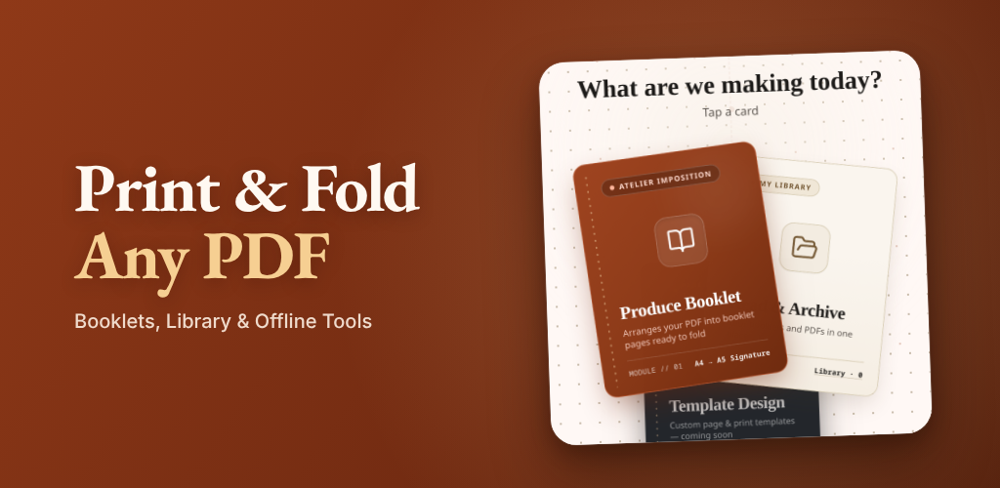
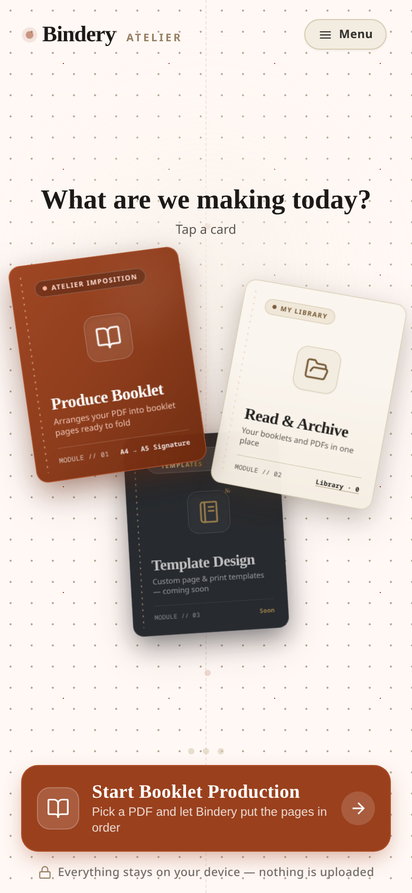
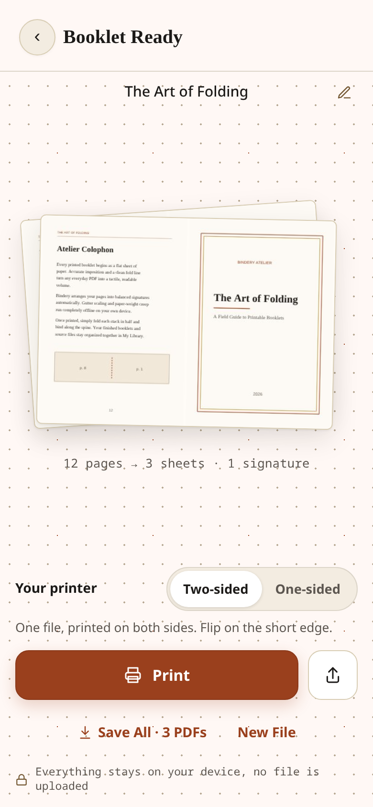
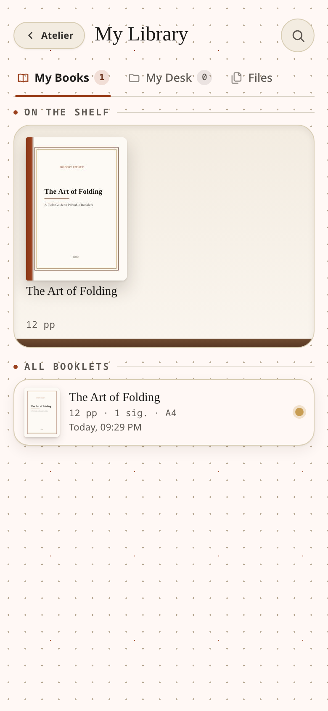
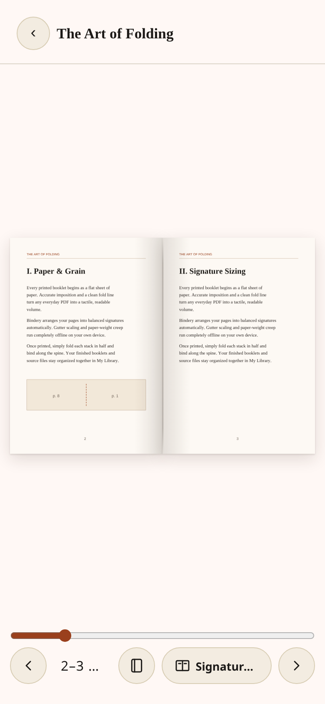
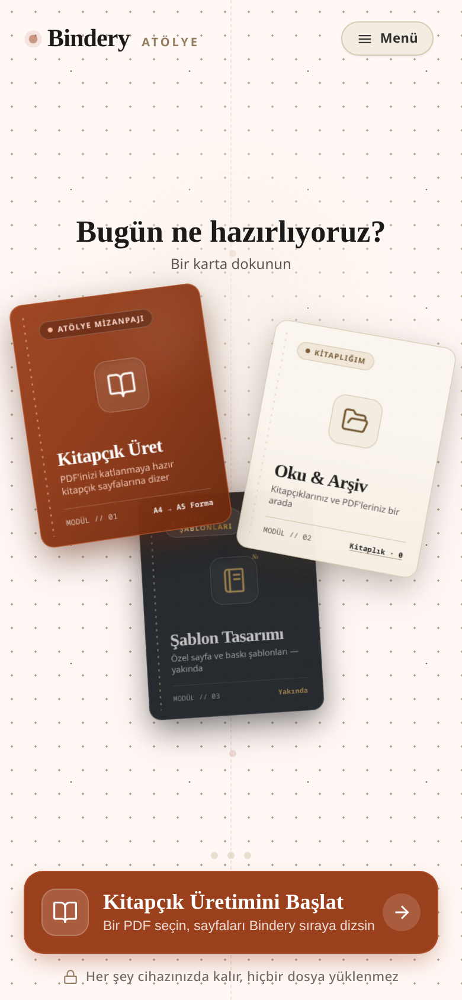
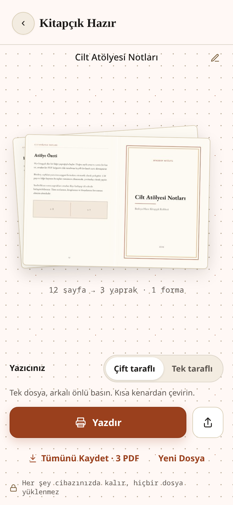
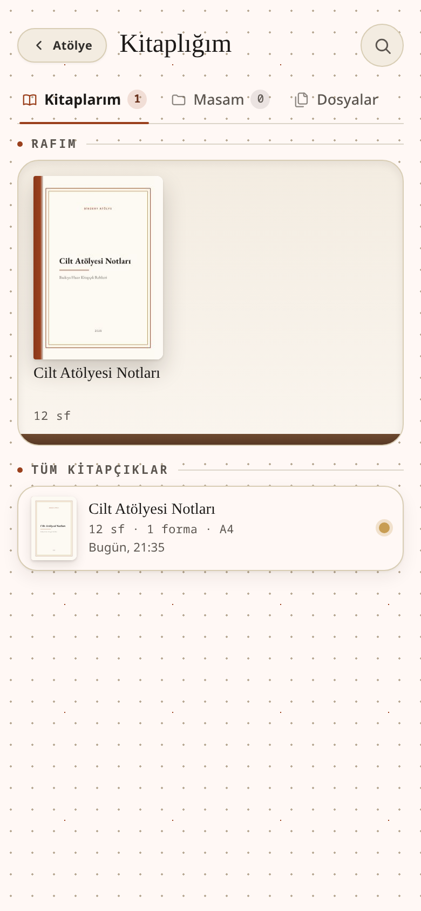
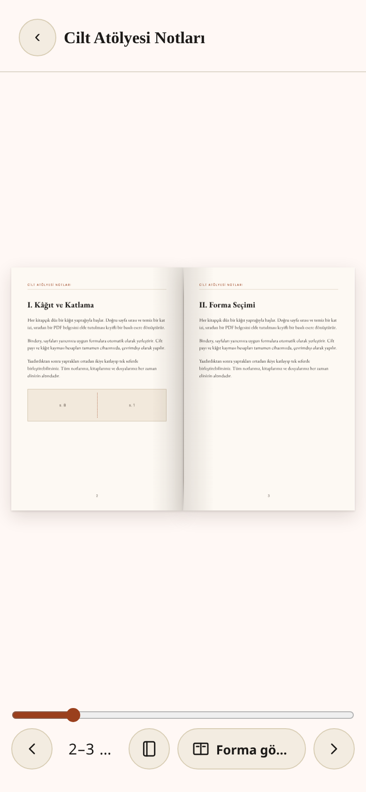

# Bindery: All-in-One PDF Tools

**Language / Dil:**
- [English](#-english)
- [Türkçe](#-türkçe)

---

<a name="-english"></a>
## English



Bindery is a mobile-first, privacy-focused PDF toolkit for phones and the browser. Every core tool — booklet making, merging, page management, watermarking — runs entirely on your device, with nothing uploaded.

### Try it now

Open **[https://yusakru.github.io/bindery/](https://yusakru.github.io/bindery/)** — one link for every device: Android visits go to Google Play on first open, while iPhone and desktop run directly in the browser and can be added to the home screen.

You can also go straight to [Bindery on Google Play](https://play.google.com/store/apps/details?id=com.eduplayconnect.bindery), or build it from this repository yourself (see [Development & Build](#development--build)).

### Why Privacy-Focused?

Every operation on your existing files — merging, page management, conversion, booklet making — happens **entirely locally, on your device's CPU**. Your files never leave your device; nothing is uploaded to a server, and nothing is shared with any analytics or tracking service. The one feature that touches the network is optional: importing a PDF from a URL you provide. Everything else stays local — and since Bindery is open source, you can verify that yourself.

### Features

- **Booklet Maker** — Turns a PDF into a foldable booklet layout
  - Multi-signature imposition for thick documents (**Auto** balanced signatures by default, plus 8/16/32-page presets and per-signature creep)
  - Paper size selection (A4 / Letter / A5 / A3 / source size), duplex flip-edge (short/long) support
  - Print-ready input: pages are imposed at their trim box (bleed and printer's marks left out) and with their `/Rotate` applied
  - Gutter that shrinks pages instead of cutting the outer edge; creep set by hand or from paper weight, clipped at the fold
  - Right-to-left (RTL) binding, separate cover export for heavier stock
  - Blank page insertion at chosen positions, printed instructions sheet with a reading-order check
  - Optional assembly marks — a dashed fold guide, plus stepped spine marks whose even spacing breaks when a signature is missing or out of order
  - Reversed sheet order for printers with an automatic folding unit
  - Interactive "what is a signature?" explainer with a live 3D folding animation
- **Markdown to Booklet** — Turns one or more `.md` files into a print-ready A5 booklet: headings, tables, code blocks and box-drawing diagrams, three calibrated type sizes (Compact 8pt / Standard 9.5pt / Comfortable 11pt), and optional recto chapter starts
- **PDF Merge** — Combines multiple PDFs into a single file
- **Page Management** — Add, delete, and reorder pages
- **Page Rotation**
- **Page Numbering**
- **Watermarking**
- **Image-to-PDF + Perspective Correction** — Convert photos to clean PDF with automatic perspective correction
- **Built-in PDF & Book Reader**:
  - Two-page **Book View** spread mode with page scrubber and signature navigation
  - Night mode (canvas-level smart color inversion)
  - Text selection / copying
  - In-document text search
  - Resume from last-read page
- **Unified Library & Local Files** — Saved booklets, recents, and local folders in one shelf, with sorting and direct tool actions

### Screenshots

| Atelier Hub | Booklet Result |
|---|---|
|  |  |

| My Library | Book View Reader |
|---|---|
|  |  |

### Development & Build

```bash
npm run test && npm run build
npx cap sync
npx cap run android
```

> **Note:** Ensure `$ANDROID_HOME` and `$JAVA_HOME` (Java 21) are configured in your environment, or simply open `android/` in Android Studio.

### License

This project is licensed under **GPL-3.0**. See [`LICENSE`](LICENSE) for the full text and [`LICENSING.md`](LICENSING.md) for the rationale behind this license choice.

---

<a name="-türkçe"></a>
## Türkçe


Bindery, telefonlar ve tarayıcı için mobil öncelikli, gizlilik odaklı bir PDF araç setidir. Kitapçık hazırlama, birleştirme, sayfa düzenleme, filigran gibi tüm çekirdek araçlar hiçbir şey yüklenmeden tamamen cihazınızda çalışır.

### Hemen deneyin

**[https://yusakru.github.io/bindery/](https://yusakru.github.io/bindery/)** adresini açın — her cihaz için tek bağlantı: Android'de ilk ziyarette Google Play'e yönlendirir; iPhone ve masaüstünde doğrudan tarayıcıda çalışır ve ana ekrana eklenebilir.

Doğrudan [Google Play'de Bindery](https://play.google.com/store/apps/details?id=com.eduplayconnect.bindery) sayfasını da açabilir ya da bu depodan kendiniz derleyebilirsiniz (bkz. [Geliştirme & Derleme](#geliştirme--derleme)).

### Neden Gizlilik Odaklı?

Var olan dosyalarınız üzerindeki tüm işlemler — birleştirme, sayfa düzenleme, dönüştürme, kitapçık oluşturma — **cihazınızın CPU'sunda, tamamen yerel olarak** gerçekleşir. Dosyalarınız hiçbir zaman cihazınızdan çıkmaz; hiçbir sunucuya yüklenmez, hiçbir analitik/izleme servisiyle paylaşılmaz. Ağa dokunan tek özellik opsiyoneldir: verdiğiniz bir URL'den PDF içe aktarma. Geri kalan her şey yerelde kalır — ve Bindery açık kaynak olduğu için bunu kendiniz doğrulayabilirsiniz.

### Özellikler

- **Kitapçık (Booklet) Oluşturucu** — PDF'i katlanabilir kitapçık düzenine getirir
  - Kalın belgeler için çoklu forma dizgisi (varsayılan **Otomatik** dengeli formalar, 8/16/32 sayfalık seçenekler ve forma başına creep)
  - Kağıt boyutu seçimi (A4 / Letter / A5 / A3 / kaynak boyutu), duplex çevirme kenarı (kısa/uzun) desteği
  - Baskıya hazır girdi: sayfalar kesim kutusuna (TrimBox) göre, taşma payı ve kesim işaretleri dışarıda bırakılarak ve `/Rotate` döndürmesi uygulanarak yerleştirilir
  - Dış kenarı kesmek yerine sayfayı küçülten orta boşluk; elle ya da kağıt gramajından ayarlanan, katlama çizgisinde kırpılan creep
  - Sağdan (RTL) ciltleme, kalın kağıt için ayrı kapak çıktısı
  - İstenen konuma boş sayfa ekleme, okuma sırası kontrolü içeren baskı talimat sayfası
  - İsteğe bağlı montaj işaretleri — kesikli katlama kılavuzu ve eksik ya da sırası bozuk formada düzenli basamak aralığı bozulan sırt işaretleri
  - Otomatik katlama üniteli yazıcılar için ters yaprak sırası
  - Canlı 3B katlama animasyonuyla interaktif "forma nedir?" açıklaması
- **Markdown'dan Kitapçık** — Bir ya da daha fazla `.md` dosyasını basıma hazır A5 kitapçığa dönüştürür: başlıklar, tablolar, kod blokları ve kutu çizgili şemalar; üç kalibre edilmiş punto (Kompakt 8pt / Standart 9,5pt / Rahat 11pt) ve istenirse bölümleri tek sayfadan başlatma
- **PDF Birleştir** — Birden fazla PDF'i tek dosyada birleştirir
- **Sayfa Yönetimi** — Sayfa ekleme, silme, yeniden sıralama
- **Sayfa Döndürme**
- **Sayfa Numarası Ekleme**
- **Filigran (Watermark) Ekleme**
- **Görselden PDF + Perspektif Düzeltme** — Fotoğraflardan PDF oluşturma, otomatik perspektif düzeltme
- **Dahili PDF & Kitap Okuyucu**:
  - Sayfa çubuğu ve forma görünümüyle iki sayfalık **Kitap Görünümü** okuyucu
  - Gece modu (canvas seviyesinde akıllı renk tersine çevirme)
  - Metin seçme / kopyalama
  - Belge içi metin arama
  - Son okunan sayfadan devam etme
- **Birleşik Kütüphane & Yerel Dosyalar** — Kayıtlı kitapçıklar, son belgeler ve yerel klasörler tek rafta; sıralama ve doğrudan araç açma desteği

### Ekran Görüntüleri

| Atölye Ana Ekran | Kitapçık Sonuç Ekranı |
|---|---|
|  |  |

| Kütüphanem | Kitap Görünümü Okuyucu |
|---|---|
|  |  |

### Geliştirme & Derleme

```bash
npm run test && npm run build
npx cap sync
npx cap run android
```

> **Not:** Ortamınızda `$ANDROID_HOME` ve `$JAVA_HOME` (Java 21) değişkenlerinin tanımlı olduğundan emin olun veya doğrudan Android Studio ile `android/` klasörünü açın.

### Lisans

Bu proje **GPL-3.0** ile lisanslanmıştır. Tam metin için [`LICENSE`](LICENSE) dosyasına, lisans seçim gerekçesi için [`LICENSING.md`](LICENSING.md) dosyasına bakın.
